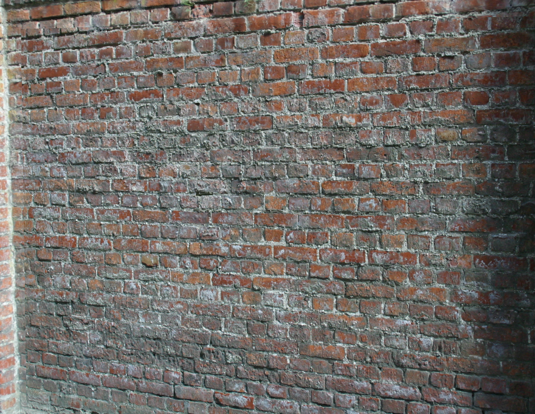

# Image Feature Matching

A C++ computer vision project developed for COSC342 at the University of Otago. Uses OpenCV to detect and match image features, estimate geometric transformations, and create an image mosaic.

The program uses SIFT for feature detection, FLANN for feature matching, and RANSAC for homography estimation.

## Project Structure

- `features.cpp` – Main feature matching and mosaicking implementation.
- `Timer.cpp` / `Timer.h` – Measures processing time.
- `viewpoint_2/` – Sample images and homography data.
- `images/` – Generated mosaic output.
- `CMakeLists.txt` – Build configuration.

## Requirements

- C++14-compatible compiler
- CMake
- OpenCV

## Compile and Run

Using MSYS2 UCRT64 on Windows with OpenCV installed:

```bash
cmake -S . -B build -G Ninja -DOpenCV_DIR=/ucrt64/lib/cmake/opencv5
cmake --build build
./build/features.exe
```

Run from the project directory so the sample images can be found.

The program displays the feature matches and resulting mosaic, and saves the mosaic to `images/mosaic.png`.

## Example Output

